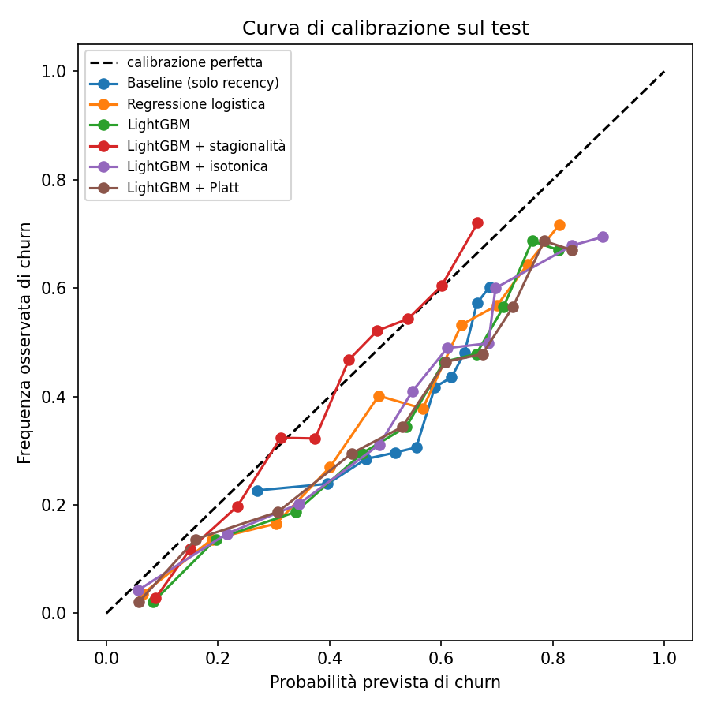
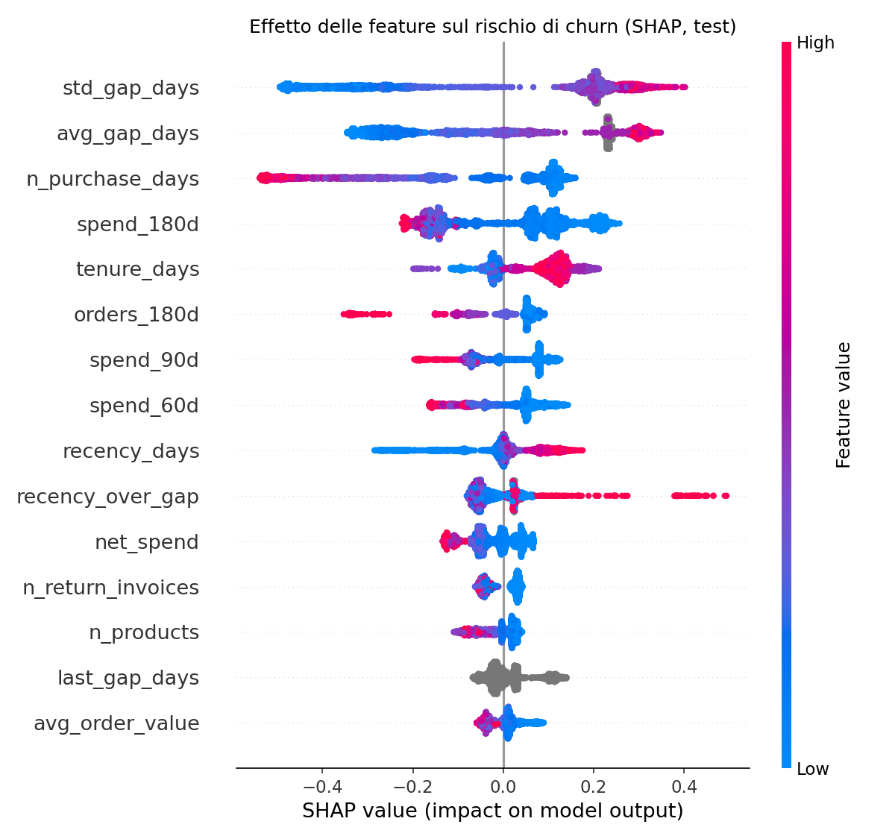
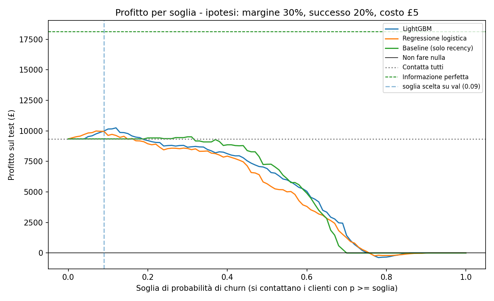

# Churn prediction on e-commerce data (Online Retail II)

*🇮🇹 [Leggi in italiano](README_it.md)*

End-to-end project on real transactional data: cleaning and feature engineering in **SQL (DuckDB)**, models in **Python**
(logistic regression, LightGBM), validation with a **temporal split** (*expanding-window* for tuning), calibration
(Platt scaling and isotonic), interpretability with **SHAP**, automated tests (**pytest**) and an economic analysis of the
intervention threshold with a sensitivity study.

The goal is not to maximize a metric, but to show a rigorous workflow: no data leakage, a realistic definition of the
active population, honest baselines, quantified uncertainty and stated limitations.

## Results at a glance

- Churn is defined as *"an active customer (at least one purchase in the last 180 days) does not generate positive net
  spend in the 90 days following the cut-off date"*.
- On the test period (September-December 2011, 2,783 active customers, 38.5% churn) **Logistic regression**
  (ROC-AUC **0.765**, PR-AUC **0.632**) and **LightGBM** (ROC-AUC **0.762**, PR-AUC **0.615**) clearly beat the
  recency-only baseline (ROC-AUC 0.655, PR-AUC 0.529), a gain of about **+0.11 ROC-AUC**.
- **Simple vs complex model:** on this data logistic regression (with an `arcsinh` transform and scaling) holds its own
  against LightGBM in ranking and produces better probabilities (Brier 0.202 vs 0.210; LogLoss 0.584 vs 0.601).
- **Calibration:** **Platt (Sigmoid)** calibration is more stable than isotonic (which overfits the single validation cut)
  and brings a real gain in the expected-value rule (**+£498** compared with raw LightGBM).
- **Economic impact and sensitivity:** in the base scenario (30% margin, 20% success rate, £5 cost) the expected-value
  rule with `LightGBM + Platt` generates **£10,769** (+£1,426 vs *Contact everyone*, +£765 vs *Value only, no model*),
  essentially on par with Logistic regression (£10,716). The model beats the alternatives in **all 9** sensitivity
  scenarios, becoming decisive when the contact cost rises (£10) or the effectiveness drops (10%).

## Data

[Online Retail II](https://archive.ics.uci.edu/dataset/502/online+retail+ii) (UCI Machine Learning Repository):
transactions of a UK-based online retailer of gift items (B2B/wholesale and B2C mix), from 1 December 2009 to
9 December 2011. The Excel file has two sheets (2009-2010 and 2010-2011) that overlap in December 2010. License and
terms of use are those given on the UCI page. **The data is not included in the repository.**

Cleaning (`sql/01_clean.sql`, per-rule counts are not mutually exclusive):

| Step | Rows |
|---|---:|
| Total rows after removing the sheet overlap (22,523 removed) | 1,044,848 |
| Missing Customer ID | 235,287 |
| Non-product StockCode (POST, DOT, M, ...) | 5,992 |
| Price <= 0 | 6,029 |
| Quantity inconsistent with invoice type (returns/purchases) | 3,394 |
| Exact duplicates removed (estimate on valid rows) | 11,665 |
| **Final clean rows (`transactions_clean`)** | **794,163** |

The number of distinct customers with at least one purchase is 5,852.

## How the problem is set up

For each **cut-off date**, one row per customer is built:

- **Features**: computed only with transactions *before* the cut-off (`sql/02_features.sql`).
- **Label (`churn`)**: `1` if the customer has **no** positive net spend (`purchases - returns > 0`) in the 90 days
  *after* the cut-off. This avoids counting customers whose orders are immediately cancelled as active (a known quirk
  of Online Retail II).
- **Active population**: only customers with at least one purchase in the last **180 days** before the cut-off are
  included. This removes "zombie customers" (inactive for over a year, trivial to classify as churn) and keeps the
  time scale consistent between the first train cut-off and the test.

Cut-offs are spaced 90 days apart (equal to the churn horizon), so no train/validation label "looks" into the test
period:

| Split | Cut-off date | Active customers | Churn |
|---|---|---:|---:|
| train | 2010-06-17, 2010-09-15, 2010-12-14, 2011-03-14 | 12,239 | 53.9% |
| validation | 2011-06-12 | 2,630 | 50.4% |
| test | 2011-09-10 | 2,783 | 38.5% |

**Automatic anti-leakage checks (`tests/test_dataset.py`)**: 4 `pytest` tests verify the absence of duplicates on
`(customer_id, snapshot_date)`, the validity of the target, compliance with the recency bounds
(`1 <= recency_days <= 180`), the non-negativity of net spend and the chronological separation of at least 90 days
between splits.

**Features (32)**: classic RFM, net spend (`net_spend`), rolling windows (30/60/90/180 days), normalized rates
(`orders_per_30d`), absolute and relative trends (`spend_ratio_90d`, `spend_share_90d`), purchase regularity
(`avg_gap_days`, `std_gap_days`, `last_gap_days`, `recency_over_gap`), B2B vs B2C signals (`avg_qty_per_line`,
`avg_unit_price`), returns and country. The gap features are missing for customers with a single purchase day: LightGBM
handles them natively, while logistic regression uses median imputation + missingness indicators.

## Models and evaluation

1. **Baseline**: logistic regression with `recency_days` only
2. **Logistic regression**: all 32 features (`arcsinh` + `StandardScaler`, `C` chosen on `val`)
3. **LightGBM**: tuning with Optuna (30 trials) through **expanding-window temporal validation** over multiple cut-offs
   (`train` + `val`)
4. **LightGBM + seasonality**: adds the month of the cut-off (`snapshot_month`)
5. **LightGBM + isotonic**: isotonic calibration trained on `val`
6. **LightGBM + Platt**: Sigmoid calibration (Platt scaling) trained on `val`

Results on the **test set** (churn share = 38.5%; a random model would have PR-AUC ≈ 0.385):

| Model | ROC-AUC | PR-AUC | Brier | LogLoss |
|---|---:|---:|---:|---:|
| Baseline (recency only) | 0.6550 | 0.5286 | 0.2470 | 0.6868 |
| **Logistic regression** | **0.7646** | **0.6324** | 0.2021 | 0.5839 |
| LightGBM | 0.7616 | 0.6152 | 0.2096 | 0.6009 |
| LightGBM + seasonality | 0.7587 | 0.6280 | **0.1923** | **0.5621** |
| LightGBM + isotonic | 0.7611 | 0.6085 | 0.2104 | 0.6121 |
| LightGBM + Platt | 0.7616 | 0.6152 | 0.2094 | 0.6003 |

### Uncertainty (paired bootstrap on the test set)

Differences on the same samples (1,000 resamples with replacement, 95% CI, A minus B):

| Comparison (A - B) | ROC-AUC | PR-AUC | Brier (↓ better) | LogLoss (↓ better) |
|---|---|---|---|---|
| LightGBM - Baseline | +0.107 [+0.086, +0.128] | +0.087 [+0.056, +0.115] | -0.037 [-0.044, -0.031] | -0.086 [-0.102, -0.072] |
| Logistic reg. - Baseline | +0.110 [+0.089, +0.130] | +0.104 [+0.073, +0.134] | -0.045 [-0.052, -0.039] | -0.103 [-0.119, -0.088] |
| LightGBM - Logistic reg. | -0.003 [-0.008, +0.003] | -0.017 [-0.032, -0.003] | +0.008 [+0.005, +0.010] | +0.017 [+0.012, +0.022] |
| LightGBM + seasonality - LightGBM | -0.003 [-0.008, +0.002] | +0.013 [-0.006, +0.030] | -0.017 [-0.022, -0.012] | -0.039 [-0.050, -0.027] |
| LightGBM + Platt - LightGBM | 0.000 [0.000, 0.000] | 0.000 [0.000, 0.000] | -0.0001 [-0.0008, +0.0005] | -0.0007 [-0.0027, +0.0013] |
| LightGBM + isotonic - LightGBM | -0.001 [-0.002, +0.001] | -0.007 [-0.015, -0.000] | +0.0009 [-0.0004, +0.0020] | +0.0112 [+0.0008, +0.0257] |

Takeaway: both full models clearly beat the baseline. Logistic regression is even better than raw LightGBM on PR-AUC,
Brier and LogLoss (unsurprisingly, Optuna picks very shallow trees with `num_leaves = 4`). Seasonality clearly improves
Brier and LogLoss because the model saw September 2010 in the train set (churn 38.8%) and recognizes the pre-Christmas
peak in the test period (churn 38.5%); it should still be used with caution, having only two years of history.

### Calibration



The models without seasonality **overestimate** churn on the test set, because they were trained/validated on periods with a
higher average churn (50-54% vs 38.5% in the pre-Christmas quarter). Isotonic calibration worsens PR-AUC and LogLoss
because it overfits the summer validation cut-off, while Platt scaling preserves the ranking and remains stable.

## Interpretability (SHAP)



The most influential features are purchase regularity (`std_gap_days`, `avg_gap_days`), historical frequency
(`n_purchase_days`, `orders_180d`) and recent spend (`spend_180d`, `spend_90d`):
- missing `std_gap_days` and `avg_gap_days` (customers with a single purchase day) strongly push towards churn.
- a high `tenure_days` increases the risk *all other features being equal* (the same number of orders spread over a
  longer time = lower frequency): it is a conditional effect, not a causal one.

## Economic threshold analysis and sensitivity

Working assumptions (adjustable from the command line, not real company data): gross margin **30%**, probability of
retaining an at-risk customer (`save_rate`) **20%**, cost per contact **£5**. The value of a customer is estimated as
their historical **net spend** over 90 days (capped at the 99th percentile of the train set).

| Strategy | Customers contacted | Churners reached | Test profit |
|---|---:|---:|---:|
| Do nothing | 0.0% | 0.0% | £0 |
| Contact everyone | 100.0% | 100.0% | £9,344 |
| Recency baseline, threshold 0.00 (on val) | 100.0% | 100.0% | £9,344 |
| Logistic regression, threshold 0.09 (on val) | 92.8% | 99.6% | £9,959 |
| LightGBM, threshold 0.09 (on val) | 94.6% | 99.9% | £9,992 |
| Value only, no model (`54% × 0.2 × value > cost`) | 80.9% | 68.1% | £10,005 |
| LightGBM, expected-value rule (`p × 0.2 × value > cost`) | 86.7% | 81.1% | £10,271 |
| Logistic regression, expected-value rule | 82.0% | 79.1% | £10,716 |
| **LightGBM + Platt, expected-value rule** | **82.1%** | **81.1%** | **£10,769** |
| *Theoretical limit with perfect information* | | | *£18,123* |



Profit differences on the test set (95% bootstrap):
- `LightGBM + Platt` vs raw `LightGBM` (expected value): **+£498** `[+248, +689]`
- `LightGBM` vs `Logistic regression` (expected value): **-£445** `[-592, -314]`
- `LightGBM` expected value vs `Value only, no model`: **+£266** `[+122, +425]`

### Sensitivity analysis (`LightGBM + Platt`, expected-value rule)

| `save_rate` | Cost (£) | Contacted (%) | Model profit (£) | vs Contact everyone (£) | vs Value only (£) |
|---:|---:|---:|---:|---:|---:|
| 10% | 2.0 | 90.0% | 6,346.9 | +283.5 | +130.4 |
| 10% | 5.0 | 43.3% | 2,120.6 | +4,406.2 | +1,649.4 |
| 10% | 10.0 | 10.5% | 637.4 | **+16,838.0** | **+3,688.6** |
| 20% | 2.0 | 98.7% | 17,728.6 | +35.7 | +21.1 |
| 20% | 5.0 | 82.1% | 10,769.4 | +1,425.5 | +764.7 |
| 20% | 10.0 | 43.3% | 4,241.2 | **+8,812.3** | **+3,298.7** |
| 30% | 2.0 | 99.3% | 29,340.0 | +17.7 | +1.9 |
| 30% | 5.0 | 93.8% | 21,443.5 | +470.2 | +230.4 |
| 30% | 10.0 | 68.5% | 11,617.2 | +4,558.9 | +2,060.0 |

When contacting is cheap (£2), almost all customers are profitable and the model adds little. When instead the cost
rises (£10) or the save rate drops (10%), selecting customers through the model avoids heavy losses and clearly beats even
the rule based on customer value alone.

## Limitations and future work

- **Seasonality over only 2 years**: `val` (June-September, summer) and `test` (September-December, Christmas peak) have
  structurally different churn rates (50.4% vs 38.5%). With only 24 months it is not possible to robustly validate the
  seasonal effect over multiple annual cycles.
- **Churn prediction vs uplift modeling**: the economic analysis assumes a constant `save_rate` for all churners. In
  reality the retention probability depends on the customer profile; estimating it properly would require a
  randomized A/B experiment and an **uplift** model.
- **Probabilistic benchmarks (BG/NBD)**: in non-contractual retail a natural extension is the comparison with
  *Buy 'Til You Die* statistical models (e.g. BG/NBD + Gamma-Gamma) to jointly estimate the probability of being active
  and CLV.
- **Bootstrap**: the intervals measure the sampling variability over the test customers, not the variability linked to
  the choice of period or to retraining.

## Repository structure

```text
sql/
  01_clean.sql          cleaning, deduplication and transactions_clean / purchases / returns tables
  02_features.sql       features (32) and churn label on net spend per cut-off date
src/
  load_data.py          Excel -> DuckDB, merging sheets without overlaps, SQL cleaning
  build_dataset.py      cut-off dates, temporal split, dataset table
  train_models.py       baseline, logistic regression, LightGBM (temporal CV), Platt/isotonic calibration
  analyze_results.py    SHAP, economic threshold analysis, profit bootstrap and sensitivity
  bootstrap_ci.py       paired confidence intervals on the test metrics
  run_all.py            runs the whole pipeline in order
tests/
  test_dataset.py       pytest tests on integrity, duplicates, active population and anti-leakage
reports/                charts and result tables
```

## How to reproduce

Tested with Python 3.13.

```bash
pip install -r requirements.txt
# download online_retail_II.xlsx from the UCI page and put it in data/online_retail_II.xlsx
python src/run_all.py
python -m pytest
```

Loading the Excel file takes 1-2 minutes; `python src/run_all.py --skip-load` skips it if `data/retail.duckdb` already
exists. The economic parameters can be varied from the command line, for example:
`python src/analyze_results.py --margin 0.25 --save-rate 0.15 --cost 8`.