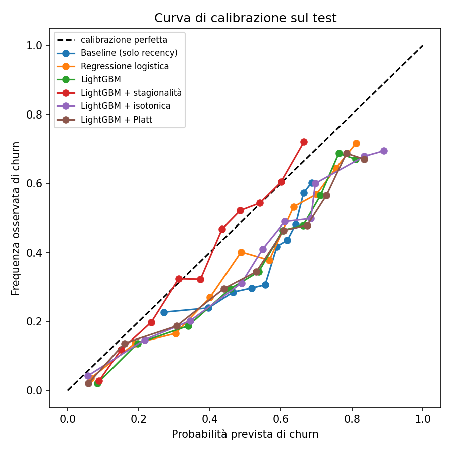
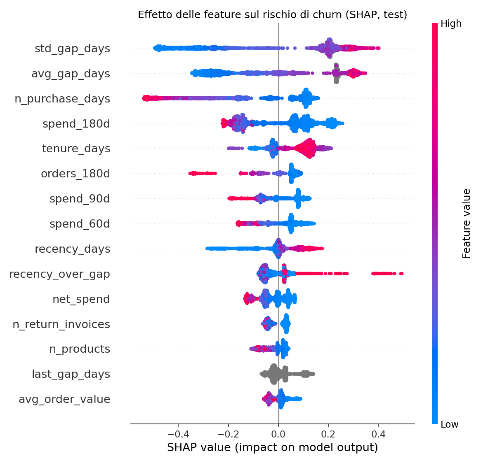
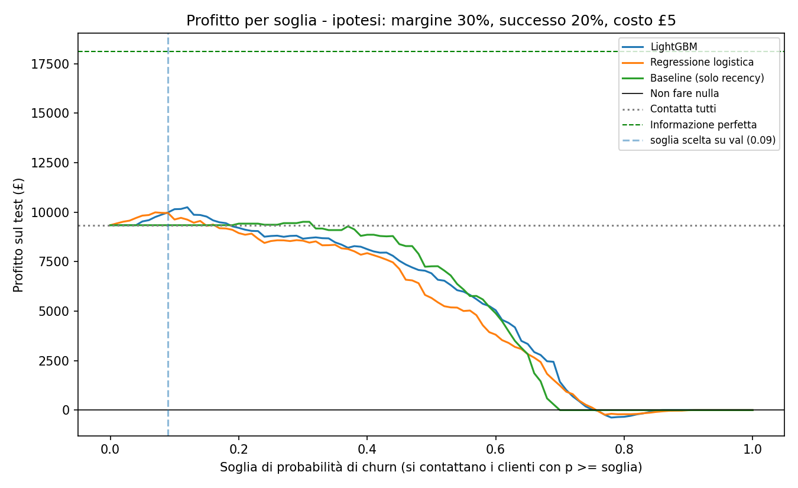

# Predizione del churn su dati e-commerce (Online Retail II)

*🇬🇧 [Read in English](README.md)*

Progetto end-to-end su dati transazionali reali: pulizia e feature engineering in **SQL (DuckDB)**, modelli in **Python**
(regressione logistica, LightGBM), validazione con **split temporale** (*expanding-window* per il tuning), calibrazione
(Platt scaling e isotonica), interpretabilità con **SHAP**, test automatici (**pytest**) e un'analisi economica della
soglia di intervento con studio di sensitività.

L'obiettivo non è massimizzare una metrica, ma mostrare un flusso di lavoro rigoroso: niente data leakage, definizione
realistica della popolazione attiva, baseline oneste, incertezza quantificata e limiti dichiarati.

## Risultati in breve

- Il churn è definito come *"il cliente attivo (almeno un acquisto negli ultimi 180 giorni) non genera spesa netta positiva
  nei 90 giorni successivi alla data di taglio"*.
- Sul periodo di test (settembre-dicembre 2011, 2.783 clienti attivi, 38,5% in churn) la **Regressione logistica**
  (ROC-AUC **0,765**, PR-AUC **0,632**) e **LightGBM** (ROC-AUC **0,762**, PR-AUC **0,615**) staccano nettamente la
  baseline di sola recency (ROC-AUC 0,655, PR-AUC 0,529), con un guadagno di circa **+0,11 di ROC-AUC**.
- **Modello semplice vs complesso:** su questi dati la regressione logistica (con trasformazione `arcsinh` e scaling)
  tiene testa a LightGBM nel ranking e produce probabilità migliori (Brier 0,202 vs 0,210; LogLoss 0,584 vs 0,601).
- **Calibrazione:** la calibrazione **Platt (Sigmoid)** è più stabile dell'isotonica (che va in overfitting sul singolo
  taglio di validazione) e porta un guadagno reale nella regola di valore atteso (**+£498** rispetto a LightGBM grezzo).
- **Impatto economico e sensitività:** nello scenario base (margine 30%, successo 20%, costo £5) la regola di valore
  atteso con `LightGBM + Platt` genera **£10.769** (+£1.426 vs *Contatta tutti*, +£765 vs *Solo valore senza modello*),
  sostanzialmente alla pari con la Regressione logistica (£10.716). Il modello batte le alternative in **tutti e 9 gli
  scenari** di sensitività, diventando decisivo quando il costo di contatto sale (£10) o l'efficacia scende (10%).

## Dati

[Online Retail II](https://archive.ics.uci.edu/dataset/502/online+retail+ii) (UCI Machine Learning Repository): transazioni
di un rivenditore online britannico di articoli da regalo (mix B2B/grossisti e B2C), dal 1 dicembre 2009 al 9 dicembre 2011.
Il file Excel ha due fogli (2009-2010 e 2010-2011) che si sovrappongono in dicembre 2010. Licenza e condizioni d'uso sono
quelle indicate nella pagina UCI. **I dati non sono inclusi nel repository.**

Pulizia (`sql/01_clean.sql`, conteggi per regola non esclusivi):

| Passaggio | Righe |
|---|---:|
| Righe totali dopo rimozione sovrapposizione fogli (22.523 rimosse) | 1.044.848 |
| Senza Customer ID | 235.287 |
| StockCode non prodotto (POST, DOT, M, ...) | 5.992 |
| Prezzo <= 0 | 6.029 |
| Quantità incoerente con il tipo di fattura (resi/acquisti) | 3.394 |
| Duplicati esatti rimossi (stima su righe valide) | 11.665 |
| **Righe pulite finali (`transactions_clean`)** | **794.163** |

I clienti distinti con almeno un acquisto sono 5.852.

## Come è impostato il problema

Per ogni **data di taglio** si costruisce una riga per cliente:

- **Feature**: calcolate solo con transazioni *precedenti* al taglio (`sql/02_features.sql`).
- **Etichetta (`churn`)**: `1` se il cliente **non** ha spesa netta positiva (`acquisti - resi > 0`) nei 90 giorni
  *successivi* al taglio. Questo evita di classificare come attivi i clienti che effettuano ordini annullati subito dopo
  (un'anomalia nota di Online Retail II).
- **Popolazione attiva**: inclusi solo i clienti con almeno un acquisto negli ultimi **180 giorni** prima del taglio.
  Questo elimina i "clienti zombie" (inattivi da oltre un anno, banali da classificare come churn) e mantiene coerente la
  scala temporale tra il primo taglio di train e il test.

I tagli sono distanziati di 90 giorni (uguale all'orizzonte di churn), così nessuna etichetta di train/val "guarda" nel
periodo di test:

| Split | Data di taglio | Clienti attivi | Churn |
|---|---|---:|---:|
| train | 2010-06-17, 2010-09-15, 2010-12-14, 2011-03-14 | 12.239 | 53,9% |
| validazione | 2011-06-12 | 2.630 | 50,4% |
| test | 2011-09-10 | 2.783 | 38,5% |

**Controlli automatici anti-leakage (`tests/test_dataset.py`)**: 4 test `pytest` verificano l'assenza di duplicati su
`(customer_id, snapshot_date)`, la validità del target, il rispetto dei limiti di recency (`1 <= recency_days <= 180`),
la non-negatività della spesa netta e la separazione cronologica di almeno 90 giorni tra gli split.

**Feature (32)**: RFM classico, spesa netta (`net_spend`), finestre mobili (30/60/90/180 giorni), tassi normalizzati
(`orders_per_30d`), trend assoluti e relativi (`spend_ratio_90d`, `spend_share_90d`), regolarità d'acquisto
(`avg_gap_days`, `std_gap_days`, `last_gap_days`, `recency_over_gap`), segnali B2B vs B2C (`avg_qty_per_line`,
`avg_unit_price`), resi e paese. Gli intervalli sono mancanti per i clienti con un solo giorno d'acquisto: LightGBM li
gestisce nativamente, la regressione logistica usa imputazione mediana + indicatori di mancanza.

## Modelli e valutazione

1. **Baseline**: regressione logistica con la sola `recency_days`
2. **Regressione logistica**: tutte le 32 feature (`arcsinh` + `StandardScaler`, `C` scelto su `val`)
3. **LightGBM**: tuning con Optuna (30 prove) tramite **validazione temporale expanding-window** su più tagli (`train` + `val`)
4. **LightGBM + stagionalità**: aggiunge il mese del taglio (`snapshot_month`)
5. **LightGBM + isotonica**: calibrazione isotonica addestrata su `val`
6. **LightGBM + Platt**: calibrazione Sigmoid (Platt scaling) addestrata su `val`

Risultati sul **test** (quota di churn = 38,5%; un modello casuale avrebbe PR-AUC ≈ 0,385):

| Modello | ROC-AUC | PR-AUC | Brier | LogLoss |
|---|---:|---:|---:|---:|
| Baseline (solo recency) | 0,6550 | 0,5286 | 0,2470 | 0,6868 |
| **Regressione logistica** | **0,7646** | **0,6324** | 0,2021 | 0,5839 |
| LightGBM | 0,7616 | 0,6152 | 0,2096 | 0,6009 |
| LightGBM + stagionalità | 0,7587 | 0,6280 | **0,1923** | **0,5621** |
| LightGBM + isotonica | 0,7611 | 0,6085 | 0,2104 | 0,6121 |
| LightGBM + Platt | 0,7616 | 0,6152 | 0,2094 | 0,6003 |

### Incertezza (bootstrap appaiato sul test)

Differenze sugli stessi campioni (1.000 ricampionamenti con reinserimento, IC al 95%, A meno B):

| Confronto (A - B) | ROC-AUC | PR-AUC | Brier (↓ meglio) | LogLoss (↓ meglio) |
|---|---|---|---|---|
| LightGBM - Baseline | +0,107 [+0,086, +0,128] | +0,087 [+0,056, +0,115] | -0,037 [-0,044, -0,031] | -0,086 [-0,102, -0,072] |
| Reg. logistica - Baseline | +0,110 [+0,089, +0,130] | +0,104 [+0,073, +0,134] | -0,045 [-0,052, -0,039] | -0,103 [-0,119, -0,088] |
| LightGBM - Reg. logistica | -0,003 [-0,008, +0,003] | -0,017 [-0,032, -0,003] | +0,008 [+0,005, +0,010] | +0,017 [+0,012, +0,022] |
| LightGBM + stagionalità - LightGBM | -0,003 [-0,008, +0,002] | +0,013 [-0,006, +0,030] | -0,017 [-0,022, -0,012] | -0,039 [-0,050, -0,027] |
| LightGBM + Platt - LightGBM | 0,000 [0,000, 0,000] | 0,000 [0,000, 0,000] | -0,0001 [-0,0008, +0,0005] | -0,0007 [-0,0027, +0,0013] |
| LightGBM + isotonica - LightGBM | -0,001 [-0,002, +0,001] | -0,007 [-0,015, -0,000] | +0,0009 [-0,0004, +0,0020] | +0,0112 [+0,0008, +0,0257] |

Lettura: entrambi i modelli completi battono nettamente la baseline. La regressione logistica risulta addirittura
superiore a LightGBM grezzo su PR-AUC, Brier e LogLoss (non a caso Optuna sceglie alberi molto semplici con `num_leaves = 4`).
La stagionalità migliora nettamente Brier e LogLoss perché il modello ha visto settembre 2010 nel train (churn 38,8%) e
riconosce il picco pre-natalizio del test (churn 38,5%); va comunque usata con cautela avendo solo due anni di storico.

### Calibrazione



I modelli senza stagionalità **sovrastimano** il churn sul test, perché allenati/validati su periodi con churn medio più
alto (50–54% contro il 38,5% del trimestre pre-natalizio). La calibrazione isotonica peggiora PR-AUC e LogLoss per
overfitting sul taglio estivo di validazione, mentre Platt scaling preserva il ranking e rimane stabile.

## Interpretabilità (SHAP)



Le feature più influenti sono la regolarità d'acquisto (`std_gap_days`, `avg_gap_days`), la frequenza storica
(`n_purchase_days`, `orders_180d`) e la spesa recente (`spend_180d`, `spend_90d`):
- `std_gap_days` e `avg_gap_days` mancanti (clienti con un solo giorno d'acquisto) spingono fortemente verso il churn.
- `tenure_days` alta aumenta il rischio *a parità delle altre feature* (stesso numero di ordini diluito su più tempo =
  frequenza minore): è un effetto condizionato, non causale.

## Analisi economica della soglia e sensitività

Ipotesi di lavoro (modificabili da riga di comando, non dati reali aziendali): margine lordo **30%**, probabilità di
trattenere un cliente a rischio (`save_rate`) **20%**, costo per contatto **£5**. Il valore di un cliente è stimato
dalla sua **spesa netta** storica per 90 giorni (limitata al 99° percentile del train).

| Strategia | Clienti contattati | Churner raggiunti | Profitto test |
|---|---:|---:|---:|
| Non fare nulla | 0,0% | 0,0% | £0 |
| Contatta tutti | 100,0% | 100,0% | £9.344 |
| Baseline recency, soglia 0,00 (su val) | 100,0% | 100,0% | £9.344 |
| Regressione logistica, soglia 0,09 (su val) | 92,8% | 99,6% | £9.959 |
| LightGBM, soglia 0,09 (su val) | 94,6% | 99,9% | £9.992 |
| Solo valore, senza modello (`54% × 0,2 × valore > costo`) | 80,9% | 68,1% | £10.005 |
| LightGBM, regola di valore atteso (`p × 0,2 × valore > costo`) | 86,7% | 81,1% | £10.271 |
| Regressione logistica, regola di valore atteso | 82,0% | 79,1% | £10.716 |
| **LightGBM + Platt, regola di valore atteso** | **82,1%** | **81,1%** | **£10.769** |
| *Limite teorico con informazione perfetta* | | | *£18.123* |



Differenze di profitto sul test (bootstrap al 95%):
- `LightGBM + Platt` vs `LightGBM` grezzo (valore atteso): **+£498** `[+248, +689]`
- `LightGBM` vs `Regressione logistica` (valore atteso): **-£445** `[-592, -314]`
- `LightGBM` valore atteso vs `Solo valore senza modello`: **+£266** `[+122, +425]`

### Analisi di sensitività (`LightGBM + Platt`, regola di valore atteso)

| `save_rate` | Costo (£) | Contattati (%) | Profitto modello (£) | vs Contatta tutti (£) | vs Solo valore (£) |
|---:|---:|---:|---:|---:|---:|
| 10% | 2,0 | 90,0% | 6.346,9 | +283,5 | +130,4 |
| 10% | 5,0 | 43,3% | 2.120,6 | +4.406,2 | +1.649,4 |
| 10% | 10,0 | 10,5% | 637,4 | **+16.838,0** | **+3.688,6** |
| 20% | 2,0 | 98,7% | 17.728,6 | +35,7 | +21,1 |
| 20% | 5,0 | 82,1% | 10.769,4 | +1.425,5 | +764,7 |
| 20% | 10,0 | 43,3% | 4.241,2 | **+8.812,3** | **+3.298,7** |
| 30% | 2,0 | 99,3% | 29.340,0 | +17,7 | +1,9 |
| 30% | 5,0 | 93,8% | 21.443,5 | +470,2 | +230,4 |
| 30% | 10,0 | 68,5% | 11.617,2 | +4.558,9 | +2.060,0 |

Quando contattare costa poco (£2), quasi tutti i clienti sono profittevoli e il modello aggiunge poco. Quando invece il
costo sale (£10) o la resa scende (10%), la selezione tramite modello evita perdite ingenti e batte nettamente anche la
regola basata sul solo valore del cliente.

## Limiti e sviluppi futuri

- **Stagionalità su 2 soli anni**: `val` (giugno-settembre, estate) e `test` (settembre-dicembre, picco natalizio) hanno
  tassi di churn strutturalmente diversi (50,4% vs 38,5%). Con soli 24 mesi non è possibile validare in modo robusto
  l'effetto stagionale su più cicli annuali.
- **Churn Prediction vs Uplift Modeling**: l'analisi economica assume un `save_rate` costante per tutti i churner. Nella
  realtà la probabilità di recupero dipende dal profilo del cliente; stimarla correttamente richiederebbe un esperimento
  A/B randomizzato e un modello di **uplift**.
- **Benchmark probabilistici (BG/NBD)**: nel retail non-contrattuale un'estensione naturale è il confronto con modelli
  statistici *Buy 'Til You Die* (es. BG/NBD + Gamma-Gamma) per stimare congiuntamente probabilità di attività e CLV.
- **Bootstrap**: gli intervalli misurano la variabilità campionaria sui clienti del test, non quella legata alla scelta
  del periodo o al riaddestramento.

## Struttura del repository

```text
sql/
  01_clean.sql          pulizia, deduplica e tabelle transactions_clean / purchases / returns
  02_features.sql       feature (32) ed etichetta churn su spesa netta per data di taglio
src/
  load_data.py          Excel -> DuckDB, unione fogli senza sovrapposizioni, pulizia SQL
  build_dataset.py      date di taglio, split temporale, tabella dataset
  train_models.py       baseline, logistica, LightGBM (CV temporale), calibrazione Platt/isotonica
  analyze_results.py    SHAP, analisi economica della soglia, bootstrap profitti e sensitività
  bootstrap_ci.py       intervalli di confidenza appaiati sulle metriche di test
  run_all.py            esegue l'intera pipeline in ordine
tests/
  test_dataset.py       test pytest su integrità, duplicati, popolazione attiva e anti-leakage
reports/                grafici e tabelle dei risultati
```

## Come riprodurre

Testato con Python 3.13.

```bash
pip install -r requirements.txt
# scarica online_retail_II.xlsx dalla pagina UCI e mettilo in data/online_retail_II.xlsx
python src/run_all.py
python -m pytest
```

Il caricamento dell'Excel richiede 1-2 minuti; con `python src/run_all.py --skip-load` si salta se `data/retail.duckdb`
esiste già. I parametri economici si possono variare da riga di comando, ad esempio:
`python src/analyze_results.py --margin 0.25 --save-rate 0.15 --cost 8`.